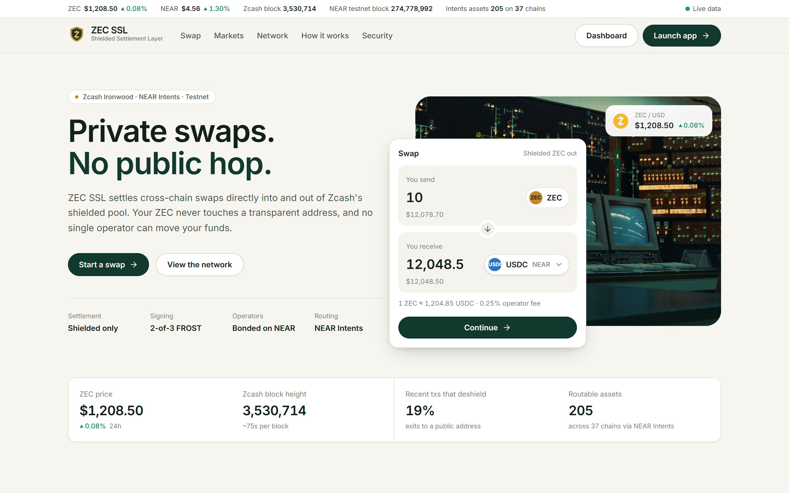
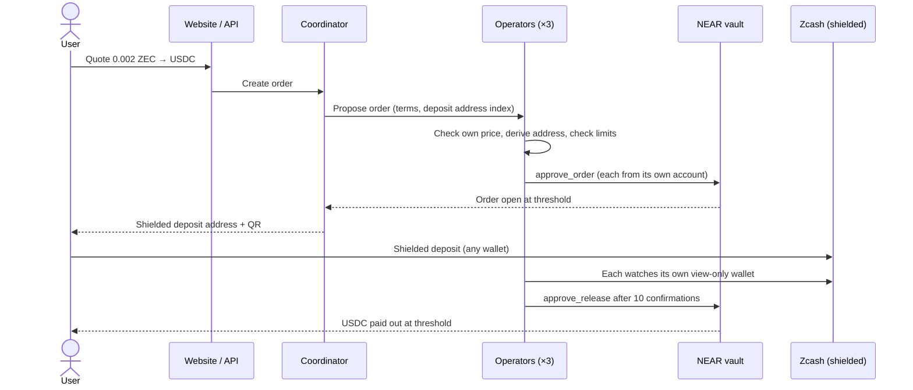
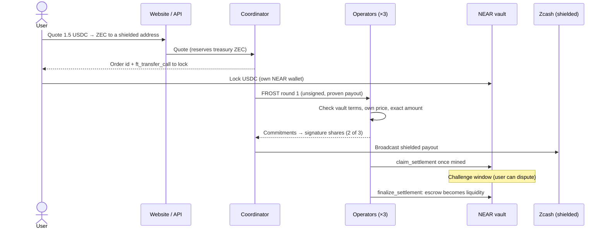
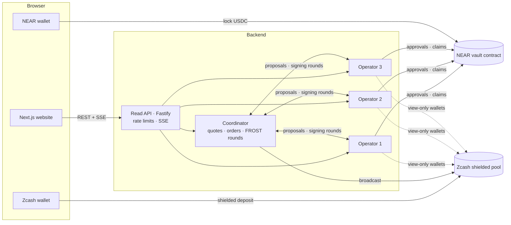

# ZEC SSL: Shielded Settlement Layer

**Private cross-chain swaps between shielded Zcash and NEAR, settled by a bonded, threshold-signing operator network.**

ZEC SSL swaps shielded ZEC for USDC on NEAR, and USDC back into shielded ZEC, without the ZEC ever touching a transparent address and without trusting any single party with user funds. Deposits and payouts happen inside Zcash's shielded pool. Settlement happens in a publicly verifiable NEAR vault contract. In between sits a network of independent operators who each hold one share of the treasury key and verify every order for themselves.

[](LICENSE)

[](https://zecssl.vercel.app)



**Live app:** [zecssl.vercel.app](https://zecssl.vercel.app), running on Zcash testnet and NEAR testnet with real on-chain data.

---

## Contents

- [Why ZEC SSL](#why-zec-ssl)
- [Features](#features)
- [How it works](#how-it-works)
- [Security model](#security-model)
- [Architecture](#architecture)
- [Repository layout](#repository-layout)
- [Getting started](#getting-started)
- [Deployment](#deployment)
- [API](#api)
- [Testing](#testing)
- [Status and roadmap](#status-and-roadmap)
- [License](#license)

## Why ZEC SSL

Moving value between a privacy chain and the rest of crypto usually means giving up the privacy. Bridges and exchanges typically require a transparent address on the way in or out, and a single custodian sees and controls the funds in between. On Zcash, a large share of transactions that leave the shielded pool do so for exactly this reason.

ZEC SSL removes both problems:

- **No public hop.** The user deposits from a shielded address and receives into a shielded address. Treasury transactions are fully shielded, and every component refuses transparent inputs or outputs.
- **No single point of trust.** The treasury key is split with FROST threshold signatures, so no operator, and not the coordinator, can move funds alone. Settlement on NEAR needs a threshold of operator approvals, and operators post slashable bonds.

## Features

### Swaps in both directions
- **Shielded ZEC → USDC on NEAR.** Get a quote, receive a fresh shielded deposit address (with QR code and a [ZIP-321](https://zips.z.cash/zip-0321) payment URI), pay from any shielded wallet, and the USDC is released to your NEAR account once the deposit is final.
- **USDC on NEAR → shielded ZEC.** Connect a NEAR wallet, lock USDC in the vault contract against a quote, and the operators pay the ZEC straight into your shielded address, then claim settlement on-chain.

### Trust-minimized by construction
- **2-of-3 rerandomized FROST** (RedPallas) signing for every treasury spend. Key shares come from a distributed key generation; no machine ever holds the whole key.
- **Operators verify everything with their own data.** Each operator:
  - derives every deposit address itself;
  - checks quotes against its own price feed;
  - watches deposits through its own view-only wallet;
  - checks every transaction it signs against the order: right recipient, exact amount, change only to the treasury, fee within bounds, nothing transparent.
- **On-chain, attributable approvals.** Operators approve from their own NEAR accounts. The vault opens, releases or refunds an order only at the threshold of identical approvals.
- **Equivocation is recorded.** An operator that approves conflicting terms for the same order is marked on-chain for slashing.
- **Bonded and capped.** Each operator bonds USDC in the vault. Value in flight can never exceed the bonds of the cheapest colluding quorum, and per-order and per-epoch caps apply on top.

### Safety nets for users
- **Automatic shielded refunds.** If a deposit is short or late, the operators never release. They jointly sign a refund back to the user's shielded refund address, minus only the network fee.
- **One refund or payout per order.** An operator never signs a second, different spend for an order while the first can still be mined, so a refund can't be paid twice.
- **Reclaim and challenge.** In the USDC → ZEC direction, the user's tokens stay escrowed in the contract. If the operators don't pay before the deadline, the user reclaims them. If operators claim without paying, the user challenges, and arbiters resolve it from the operators' bonds.
- **Liveness under failure.** Any operator that checked a broadcast spend can settle it, so one operator going offline doesn't stall a refund or payout.

### Live transparency
- **A real-time dashboard**, streamed over Server-Sent Events:
  - market data;
  - Zcash and NEAR chain heads;
  - routable assets via NEAR Intents;
  - every order, signing round and event;
  - operator health, bonds and vault liquidity.
- **Per-order pages** with the full trail: deposit, confirmations, signing rounds, each operator's on-chain approval, and the refund or payout transaction, all linked to block explorers.
- **Live reserve check.** The vault's books are reconciled against the token contract's balance and shown on the Treasury page.
- **Testnet faucet page** that registers NEAR accounts with the vault token and drips test USDC.

### Hardened for the open internet
- **Rate limits.** Per-IP limits on every route, with tight limits where an action costs gas or reserves treasury funds. The coordinator also caps open unfunded orders and unlocked quotes, in total and per account.
- **Treasury ZEC is reserved per order,** so concurrent quotes can't promise the same funds.
- **Strict security headers.** A Content Security Policy, HSTS, no framing and no MIME sniffing, on both the website and the API.
- **Parameterized SQL throughout,** and input validation on every forwarded identifier.
- **Wallet choice.** Meteor, HERE, Intear, Sender, Nightly and Ledger, through NEAR Wallet Selector.

## How it works

### Shielded ZEC → USDC



If the deposit is short after the deadline, or arrives late, the coordinator builds a refund transaction and runs a FROST signing round. Every operator re-checks it before signing, and the shielded refund goes back to the user's refund address. The operators then approve the refund on the vault, which releases the order's reservation.

### USDC → shielded ZEC



## Security model

| Party | Can | Cannot |
| --- | --- | --- |
| **Coordinator** | Quote, hand out deposit addresses, build and broadcast transactions, run signing rounds | Sign anything (it holds no key share and no NEAR key), make operators approve terms they disagree with, redirect a refund or payout |
| **One operator** | Approve, sign its share, settle | Move treasury funds alone (FROST threshold), open or release orders alone (vault threshold), approve conflicting terms without an on-chain record |
| **A threshold of operators** | Settle orders | Exceed bond-backed caps; misbehave without exposure to their bonds |
| **User** | Deposit, lock, reclaim after a missed deadline, challenge a false claim | Receive a release without a confirmed, on-time, full deposit |
| **Arbiters** | Resolve disputes and challenges, slash bonds | Act below the arbiter threshold |

The treasury wallet that the coordinator and operators run is **view-only**: it derives addresses and detects deposits but cannot spend. Spending requires a FROST signing round among the operators.

## Architecture



- **Website (Next.js 16, React 19, Tailwind 4):** marketing homepage and app (dashboard, swap in both directions, order pages, operator network, treasury, markets, activity, system status, faucet). It never calls third-party APIs directly.
- **Read API (Fastify 5, TypeScript):** polls every source on a schedule, keeps the latest snapshot in memory, and pushes changes over Server-Sent Events, so page views never hit upstream rate limits. Proxies order creation and quotes to the coordinator.
- **Coordinator and operators (Rust):** long-running services, each with its own SQLite state and its own view-only Zcash wallet syncing from lightwalletd.
- **Vault contract (Rust, near-sdk):** escrow, reservations, bonds, approvals, disputes, challenges and governance in one contract.

## Repository layout

```
zec-ssl/
├── web/                 Next.js website and app
├── server/              Read API: pollers, cache, REST, SSE, rate limits, faucet
├── protocol/            Rust workspace for the off-chain protocol
│   ├── ssl-node/        coordinator and operator services (bin/coordinator.rs, bin/operator.rs)
│   ├── ssl-policy/      the checks operators run: quotes, refunds, payouts, deposit status
│   ├── ssl-sign/        PCZT inspection: sighash, effects, applying signatures, extraction
│   ├── ssl-frost/       rerandomized FROST (RedPallas) signer and aggregator
│   ├── ssl-wallet/      view-only treasury wallet: sync, deposits, payment building, proving
│   ├── ssl-near/        minimal NEAR client: signed function calls and views
│   ├── run/             local launcher and a test user wallet
│   └── spike/           DKG and signing scripts used to create the treasury key
├── contracts/           NEAR contracts
│   ├── ssl/             the vault: orders, bonds, disputes, governance
│   └── test-token/      testnet NEP-141 "USDC" with a capped faucet
├── deploy/              Docker Compose, Caddy (HTTPS) and deployment scripts
└── docs/                deployment guides and the testnet plan
```

More detail: [protocol/README.md](protocol/README.md) and [contracts/README.md](contracts/README.md).

## Getting started

### Prerequisites
- Node.js 22+ and pnpm 10.
- Rust (stable). The contracts pin Rust 1.95 through `contracts/rust-toolchain.toml`.
- Linux or WSL for the Rust services and contract builds.

### Website and API

```bash
pnpm install
cp server/.env.example server/.env
cp web/.env.example web/.env.local
pnpm dev:server   # API on http://localhost:4000
pnpm dev:web      # website on http://localhost:3000
```

Without a coordinator configured, the site still shows live market and chain data. Order-related panels show an explicit "not connected" state rather than placeholder data.

### Coordinator and operators

```bash
cd protocol
cargo build --release -p ssl-node
VAULT=<prefix>-vault.testnet PREFIX=<prefix> bash run/start-local.sh
```

This starts three operators and the coordinator against Zcash and NEAR testnet, each with its own state directory, NEAR key and FROST share. Point `COORDINATOR_URL` and `OPERATOR_ENDPOINTS` in `server/.env` at them. See [protocol/README.md](protocol/README.md) for the full setup.

### Contracts

```bash
cd contracts
bash scripts/test.sh             # unit and sandbox tests
bash scripts/deploy-testnet.sh   # deploy the vault and test token
```

## Deployment

| Piece | Where | Guide |
| --- | --- | --- |
| Website | Vercel (root directory `web`) | [docs/deploy-oracle.md](docs/deploy-oracle.md#8-website-on-vercel) |
| Coordinator, operators, API, HTTPS | Any Linux VM with Docker Compose ([deploy/docker-compose.yml](deploy/docker-compose.yml)) | [docs/deploy-oracle.md](docs/deploy-oracle.md) |
| The same, on Render | [render.yaml](render.yaml) | [docs/deploy.md](docs/deploy.md) |

The Compose stack runs the coordinator, three operators, the read API and Caddy, with automatic HTTPS. Only Caddy is exposed. `deploy/make-env.sh` collects the keys into a git-ignored `deploy/.env`. On small servers (2 GB RAM), `deploy/push-binaries.sh` builds the Rust services locally and uploads them instead of compiling on the server.

## API

The read API serves the website. Response types live in [server/src/types.ts](server/src/types.ts).

| Method | Path | Purpose |
| --- | --- | --- |
| GET | `/v1/health` | Uptime and per-source status |
| GET | `/v1/overview` | Every snapshot in one response (first render) |
| GET | `/v1/stream` | Server-Sent Events: market, chains, intents, network, sources |
| GET | `/v1/market`, `/v1/market/:id/chart` | Prices and price history |
| GET | `/v1/zcash`, `/v1/near`, `/v1/intents/tokens`, `/v1/network` | Individual snapshots |
| POST | `/v1/quote` | Quote shielded ZEC → USDC |
| POST | `/v1/orders` | Open a ZEC → USDC order (returns the shielded deposit address) |
| GET | `/v1/orders/:id` | Order detail with vault approvals and event trail |
| POST | `/v1/payouts` | Quote USDC → ZEC and return the transfer that locks the tokens |
| GET | `/v1/accounts/:id` | NEAR account and vault-token registration status |
| GET, POST | `/v1/faucet`, `/v1/faucet/register`, `/v1/faucet/usdc` | Testnet faucet |

The coordinator and operators expose their own internal APIs: proposals, signing rounds, attestations and health. These are reachable only on the deployment's private network.

## Testing

```bash
cd protocol && cargo test --workspace   # policy, signing, FROST, NEAR client, coordinator
cd contracts && bash scripts/test.sh    # contract unit tests and sandbox tests
pnpm typecheck                          # API and website
```

What's covered:
- **Policy tests:** every operator check, including the attacks it must refuse (redirected refunds, skimmed payouts, overpaying quotes, transparent outputs).
- **Signing tests:** against a real Zcash testnet transaction fixture.
- **Contract tests:** order, dispute, cap and governance paths, plus end-to-end sandbox runs.

Exercised end to end on testnet:
- swaps in both directions;
- an underpaid refund and a late-deposit refund;
- a malicious coordinator submitting bad refunds, which operators refused;
- a coordinator crash mid-round;
- settlement with one operator offline.

## Status and roadmap

ZEC SSL runs on **Zcash testnet and NEAR testnet** today, with both swap directions, threshold-signed refunds and payouts, and the full set of user safety nets.

Next:
- **Independent operators:** separate parties on separate infrastructure, each running its own Zcash node.
- **A fresh treasury key** from a production distributed key generation.
- **An external security audit** of the contract and the signing code.
- **Mainnet deployment** with NEAR Intents routing to more destination assets.

The detailed plan and test status are in [docs/testnet-plan.md](docs/testnet-plan.md).

## License

[MIT](LICENSE)
